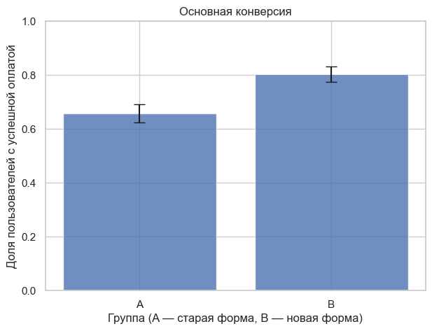
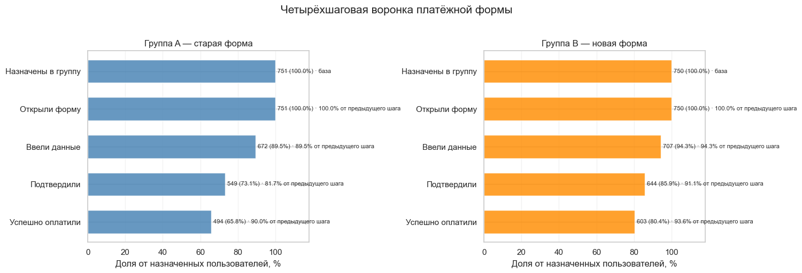
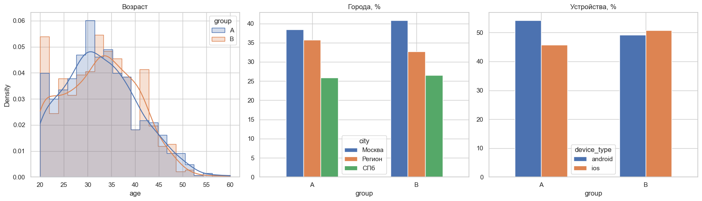

[**English**](README.md) | [Русский](README.ru.md)

# A/B Test of a Payment Form in a Banking App

**Objective:** Evaluate whether the new payment form increases the conversion rate to successful payment.

- **A** — the old form (control).
- **B** — the new form (test).

The primary metric is the proportion of assigned users who completed at least one successful payment (`step4_success`, ITT). A four-step funnel is also analyzed.

**Tech stack:** Python, pandas, NumPy, SciPy, statsmodels, Matplotlib, Seaborn.

## Project structure

```text
.
├── ab_test_analysis.ipynb
├── dannye.xlsx
├── README.md
└── assets/
    ├── conversion.png
    ├── funnel.png
    └── specifications.png
```

## Results

### Conversion to successful payment



| Metric | A — old form | B — new form |
|---|---:|---:|
| Users | 751 | 750 |
| Successful payments | 494 | 603 |
| Conversion rate | **65.78%** | **80.40%** |

Effect of B − A: **+14.62 percentage points** (relative increase of **+22.23%**). The p-values for the z-test and Fisher's exact test are both below 0.001; the 95% bootstrap confidence interval for the difference is **+10.36 to +19.02 percentage points**.

### Four-step funnel



| Stage | A | B |
|---|---:|---:|
| Opened the form | 751 (100%) | 750 (100%) |
| Entered details | 672 (89.48%) | 707 (94.27%) |
| Confirmed | 549 (73.10%) | 644 (85.87%) |
| Paid successfully | 494 (65.78%) | 603 (80.40%) |

B has a higher step-to-step conversion rate at every stage: open → enter — **94.27% vs. 89.48%**; enter → confirm — **91.09% vs. 81.70%**; confirm → payment — **93.63% vs. 89.98%**. After the Holm correction, the differences at the data-entry and confirmation stages are statistically significant (p-values: 0.000692 and 1.84 × 10⁻⁹).

### Experiment quality checks



SRM: p-value = 0.9794; age: 0.8314; city: 0.4404; device: 0.0595. No statistically significant group imbalance was detected in the characteristics tested.

## Conclusion

The new form is associated with a higher conversion rate to successful payment: **80.40% vs. 65.78%** (+14.62 percentage points). The difference is statistically significant. The funnel shows that B's advantage is already apparent at the data-entry stage and becomes more pronounced at the confirmation stage.

Before a full rollout, event logging and the consistency of the observation window across groups should be checked. Transaction amounts, revenue/fees, refunds, and declined payments should also be evaluated.

## Data and setup

`dannye.xlsx` contains two sheets: `Пользователи` (`user_id`, `group`, `age`, `city`, `device_type`) and `Платежи` (`payment_id`, `user_id`, `step1_opened`, `step2_entered`, `step3_confirmed`, `step4_success`). A stage is counted for a user if the event was recorded in at least one of their payment attempts.

Python 3.10+ is required:

```bash
python -m pip install pandas numpy matplotlib seaborn scipy statsmodels openpyxl jupyter
jupyter notebook
```

Open `ab_test_analysis_four_step_funnel_text_updated.ipynb`, check the path to the Excel file, and run the cells in order.

---

*Educational portfolio project. The conclusions apply to the data provided and the experiment period.*
