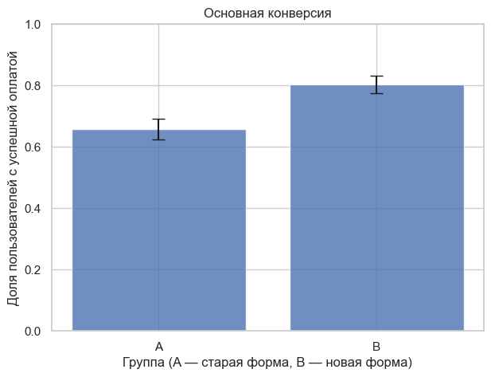
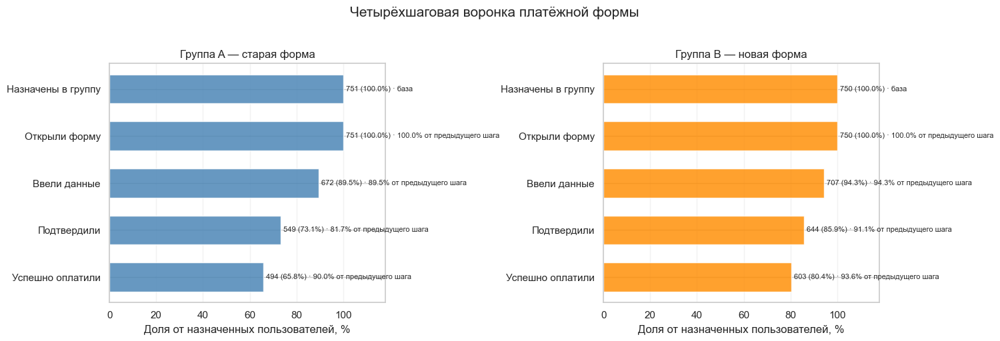
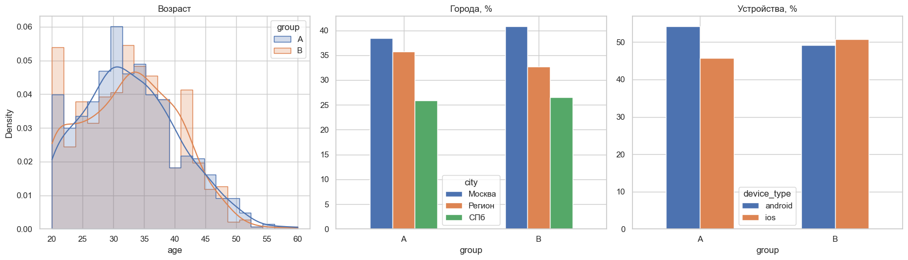

[English](README.md) | **Русский**

# A/B-тест платёжной формы в банковском приложении

**Цель:** оценить, повышает ли новая платёжная форма конверсию в успешную оплату.

- **A** — старая форма (контроль).
- **B** — новая форма (тест).

Основная метрика — доля назначенных пользователей хотя бы с одной успешной оплатой (`step4_success`, ITT). Дополнительно анализируется воронка из четырёх шагов.

**Стек:** Python, pandas, NumPy, SciPy, statsmodels, Matplotlib, Seaborn.

## Структура проекта

```text
.
├── ab_test_analysis.ipynb
├── dannye.xlsx
├── README.md
└── assets/
    ├── conversion.png
    ├── funnel.png
    └── specifications.png
```

## Результаты

### Конверсия в успешную оплату



| Показатель | A — старая | B — новая |
|---|---:|---:|
| Пользователи | 751 | 750 |
| Успешные оплаты | 494 | 603 |
| Конверсия | **65,78%** | **80,40%** |

Эффект B − A: **+14,62 п.п.** (относительный прирост **+22,23%**). p-value z-теста и критерия Фишера — менее 0,001; 95%-й bootstrap-интервал разницы — **+10,36…+19,02 п.п.**

### Четырёхшаговая воронка



| Этап | A | B |
|---|---:|---:|
| Открыли форму | 751 (100%) | 750 (100%) |
| Ввели данные | 672 (89,48%) | 707 (94,27%) |
| Подтвердили | 549 (73,10%) | 644 (85,87%) |
| Успешно оплатили | 494 (65,78%) | 603 (80,40%) |

Переходная конверсия B выше на каждом этапе: открытие → ввод — **94,27% против 89,48%**; ввод → подтверждение — **91,09% против 81,70%**; подтверждение → оплата — **93,63% против 89,98%**. После поправки Холма различия на этапах ввода и подтверждения статистически значимы (p-value: 0,000692 и 1,84 × 10⁻⁹).

### Проверки качества эксперимента



SRM: p-value = 0,9794; возраст: 0,8314; город: 0,4404; устройство: 0,0595. По проверенным признакам статистически значимого дисбаланса групп не выявлено.

## Итог

Новая форма связана с более высокой конверсией в успешную оплату: **80,40% против 65,78%** (+14,62 п.п.). Различие статистически значимо. Воронка показывает, что преимущество B проявляется уже при вводе данных и усиливается на этапе подтверждения.

Перед полным запуском следует проверить корректность логирования событий и одинаковое окно наблюдения в группах, а также оценить суммы операций, выручку/комиссию, возвраты и отклонённые платежи.

## Данные и запуск

`dannye.xlsx` содержит листы `Пользователи` (`user_id`, `group`, `age`, `city`, `device_type`) и `Платежи` (`payment_id`, `user_id`, `step1_opened`, `step2_entered`, `step3_confirmed`, `step4_success`). Этап засчитывается пользователю, если событие зафиксировано хотя бы в одной его платёжной попытке.

Требуется Python 3.10+:

```bash
python -m pip install pandas numpy matplotlib seaborn scipy statsmodels openpyxl jupyter
jupyter notebook
```

Откройте `ab_test_analysis_four_step_funnel_text_updated.ipynb`, проверьте путь к Excel-файлу и выполните ячейки последовательно.

---

*Учебный и портфолио-проект. Выводы относятся к представленным данным и периоду эксперимента.*
